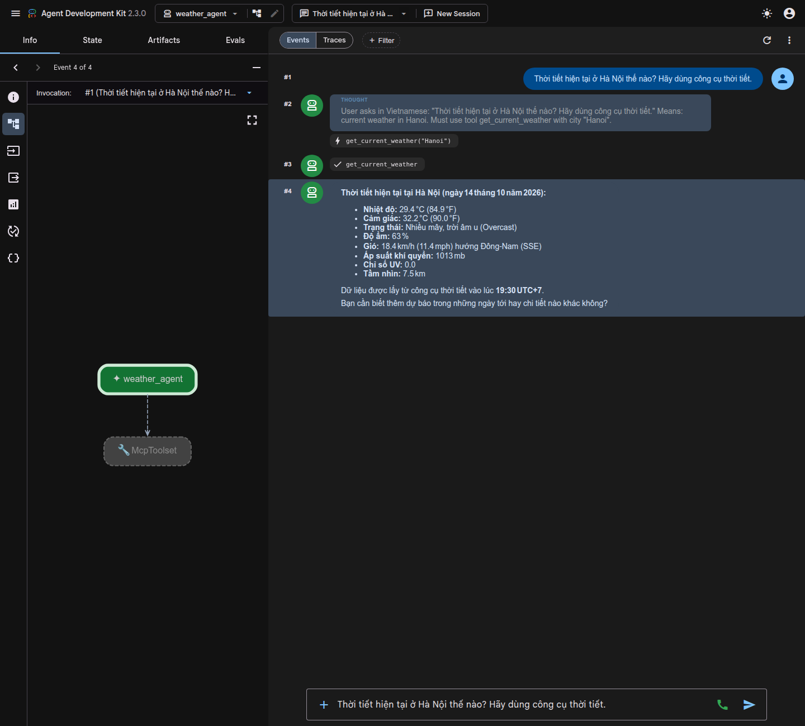

# Lab 04 — Weather Agent with Remote MCP Server

A weather agent built with Google ADK that connects to an MCP server via Streamable HTTP transport.

## Architecture

```
┌─────────────────┐   Streamable HTTP    ┌─────────────────┐      REST       ┌─────────────────┐
│ ADK + Ollama LLM│ ──────────────────── │   MCP Server    │ ─────────────── │  WeatherAPI.com │
│  (mcp-client)   │   localhost:8085/mcp │  (mcp-server)   │                 │                 │
└─────────────────┘                      └─────────────────┘                 └─────────────────┘
```

## Tools

| Tool | Description |
|------|-------------|
| `get_current_weather(city)` | Get current weather conditions for a city |
| `get_forecast(city, days)` | Get weather forecast (1–3 days) |
| `health_check()` | Verify server is running |

## ADK làm gì trong Lab này?

ADK (Agent Development Kit) đóng vai trò **MCP Client** 
```
┌─────────────────────────────────────────────────────────────────┐
│                                                                 │
│  1. KẾT NỐI tới MCP Server qua Streamable HTTP                  │
│     StreamableHTTPConnectionParams(url="localhost:8085/mcp")    │
│                                                                 │
│  2. KHÁM PHÁ tools tự động (list_tools)                         │
│     McpToolset → tự hỏi server "anh có tool gì?"                │
│     → nhận về: get_current_weather, get_forecast, health_check  │
│                                                                 │
│  3. TRUYỀN tools cho LLM (Ollama)                               │
│     Agent(model=LiteLlm("ollama_chat/gpt-oss:120b"), ...)        │
│     → Ollama biết nó có thể gọi 3 tools trên                    │
│                                                                 │
│  4. ĐIỀU PHỐI vòng lặp Function Calling                         │
│     User hỏi → Ollama chọn tool → ADK gọi MCP Server            │
│     → nhận kết quả → đưa lại cho Ollama tổng hợp                │
│                                                                 │
│  5. CUNG CẤP giao diện web (adk web)                            │
│     → http://localhost:8000 để chat với agent                   │
│                                                                 │
└─────────────────────────────────────────────────────────────────┘
```

So với bài 02 (viết client thủ công bằng `mcp.ClientSession`), ADK giúp bạn **không phải viết vòng lặp function calling thủ công** nữa. Toàn bộ luồng list_tools → model quyết định → call_tool → model tổng hợp được ADK xử lý tự động.

## Setup

### 1. MCP Server

```bash
cd mcp-server
uv sync

# Create a private environment file and set the WeatherAPI key.
cp .env.example .env

# Start the server (runs on port 8085 by default)
uv run python weather.py
```

The server will be available at `http://localhost:8085/mcp`.

### 2. ADK Agent (Client)

```bash
cd mcp-client
uv sync

# Copy the template and add your Ollama Cloud API key
cp .env.example .env

# Start ADK web interface
uv run adk web
```

Open http://localhost:8000 in your browser, select `weather_agent`, and ask about the weather.

## Configuration

| Variable | Where | Description |
|----------|-------|-------------|
| `WEATHERAPI_KEY` | mcp-server | API key from weatherapi.com |
| `OLLAMA_API_KEY` | mcp-client/.env | Ollama Cloud API key |
| `OLLAMA_MODEL` | mcp-client/.env | Model name (default: `gpt-oss:120b`) |
| `OLLAMA_API_BASE` | mcp-client/.env | Ollama endpoint (default: `https://ollama.com`) |
| `PORT` | mcp-server (env) | Override server port (default: 8085) |
| `MCP_SERVER_URL` | mcp-client/.env | MCP endpoint the agent connects to (default: `http://localhost:8085/mcp`; set to your Cloud Run URL + `/mcp` when deployed) |

## Ảnh minh chứng

Ảnh dưới đây cho thấy luồng chạy hoàn chỉnh: ADK Agent gọi `get_current_weather` thông qua `McpToolset` và trả lời từ dữ liệu WeatherAPI.



Xem thêm mô tả từng ảnh trong [`screenshots/README.md`](screenshots/README.md).
